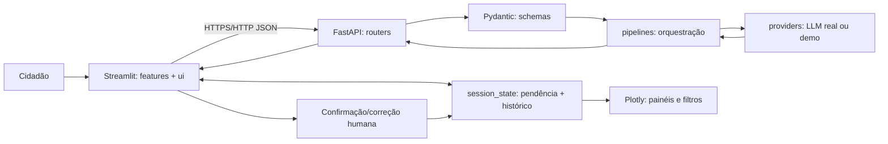

# VivaBairro — CitizenTech | Global Solution FIAP 2026.2

> **Status: POC acadêmica implementada em código; não é serviço público oficial.** O modo padrão é **demonstração simulada, sem LLM**. Para comprovar o requisito obrigatório de IA real, configure o modo `openai`, execute e documente os casos de teste antes da entrega. Não foram inventados testes com participantes, resultados de IA real, links de deploy ou vídeos.

## 1. Problema, público e justificativa baseada em fontes

**Problema delimitado:** relatos de problemas de zeladoria urbana (buracos, calçadas inacessíveis, iluminação, resíduos e drenagem) podem ser difíceis de organizar e entender por quem não domina termos técnicos. A POC estuda como uma interface simples com apoio de IA pode transformar texto livre em sugestão compreensível de classificação e orientação, **sem substituir o atendimento oficial**.

**Público:** moradores que percebem problemas em seus bairros, especialmente pessoas com menor familiaridade digital ou necessidades de acessibilidade. O bairro é suficiente para a demonstração; **não coletamos endereço completo**.

**Evidência externa:** a Prefeitura de São Paulo mantém o serviço oficial **SP156** com canais telefônicos, digitais e presenciais, e disponibiliza cartas de serviços que explicam como pedir atendimento. A própria Prefeitura publica categorias como *tapa-buraco* e reparos. Isso demonstra que os problemas e os canais municipais existem; **não demonstra que a nossa POC já melhorou o atendimento ou que é integrada ao SP156**.

- Prefeitura de São Paulo, *Perguntas Frequentes — SP156*, 16/06/2026: https://prefeitura.sp.gov.br/web/inovacao/w/acesso_a_informacao/350229
- Prefeitura de São Paulo, *Serviços do Portal 156*: https://prefeitura.sp.gov.br/web/subprefeituras/w/pracas_de_atendimento/335674

**ODS e contribuição hipotética:**

- **ODS 11 — Cidades e comunidades sustentáveis**: busca espaços públicos mais seguros e acessíveis; uma interface de relato clara pode ajudar cidadãos a descrever obstáculos urbanos. Fonte: https://brasil.un.org/pt-br/sdgs/11
- **ODS 16 — Instituições eficazes**: relaciona-se a participação e acesso à informação; organizar relatos pode apoiar comunicação cidadã. Fonte: https://brasil.un.org/pt-br/sdgs/16

**Hipótese**, não resultado medido: uma interface acessível com revisão humana reduz dificuldade de organizar a descrição inicial. É necessário testar com pessoas reais para verificar.

## 2. Fluxo CitizenTech de ponta a ponta

1. O cidadão informa **bairro, categoria e relato**. O front valida tamanho mínimo e apresenta orientações de privacidade.
2. O **Streamlit** envia JSON por HTTP para o **FastAPI**. O back-end valida a entrada com **Pydantic**.
3. Em **modo LLM real**, `backend/app/providers/llm.py` faz a chamada ao modelo no servidor, solicita um objeto JSON e valida o conteúdo contra o esquema Pydantic `ResultadoIA`.
4. O front exibe **resumo, prioridade, justificativa, orientação e tipo genérico de serviço** com mensagens e cores semânticas.
5. O cidadão revisa/corrige categoria, prioridade e resumo, ou descarta a proposta (**human-in-the-loop**).
6. Apenas após confirmação, o sistema grava um registro **local à sessão Streamlit**, que alimenta **Plotly, métricas e dois filtros**.

**Importante:** o identificador `LOCAL-XXXXXXXX` **não é protocolo municipal**. Nenhuma demanda é enviada ao SP156 ou a outro órgão. Não há banco de dados.

### Diagrama da arquitetura



### Estrutura dos arquivos

```text
VivaBairro_GS2026_2/
├── backend/
│   ├── app/
│   │   ├── main.py                 # FastAPI + CORS
│   │   ├── config.py               # configuração por env
│   │   ├── routers/analises.py     # endpoints e erros amigáveis
│   │   ├── schemas/relatos.py      # modelos Pydantic
│   │   ├── pipelines/analise.py    # orquestração, demo identificada
│   │   └── providers/llm.py        # chamada real ao LLM
│   ├── Dockerfile
│   └── requirements.txt
├── frontend/
│   ├── app.py                      # composição e navegação Streamlit
│   ├── features/                   # relatar, painel, sobre
│   ├── ui/                         # cabeçalho, indicadores, tema
│   ├── providers/api.py           # cliente HTTP (não chama o LLM)
│   ├── state/store.py             # sessão, pendências, confirmação
│   ├── visualization.py           # Plotly e filtros puros
│   ├── demo_data.py               # dados ilustrativos rotulados
│   ├── Dockerfile
│   └── requirements.txt
├── tests/                         # testes automatizados
├── docs/                          # validação, rubrica, roteiro, QA
├── .env.example
├── docker-compose.yml
└── README.md
```

## 3. Por que estas decisões técnicas?

- **Streamlit**: adequado à POC de 5 horas prevista no enunciado, permite construir formulário, navegação, histórico e Plotly rapidamente. `st.session_state` mantém a interação durante reruns e `@st.cache_data(ttl=20)` evita checagens repetidas de saúde da API. **Respostas a relatos pessoais não são armazenadas em cache compartilhado.**
- **FastAPI**: separa a UI do processamento, expõe contratos documentados e mantém segredos fora do navegador. `Pydantic` valida formato, comprimentos, categorias e a estrutura da saída.
- **LLM / prompt**: a mensagem de sistema define tarefa e limitações, pede JSON, proíbe inventar canais/protocolos e avisa que o relato é entrada não confiável. O objeto retornado é validado por `ResultadoIA`. **JSON mode sozinho não garante conformidade**; Pydantic rejeita saídas inválidas. Atualmente o provedor real usa a API Chat Completions da OpenAI, com modelo configurável.
- **Docker**: duas imagens, uma por serviço, para execução fora da máquina do estudante. Não foi possível executar Docker no ambiente usado para preparar esta entrega; antes de submeter, valide com `docker compose up --build` em máquina com Docker instalado.
- **Human-in-the-loop**: uma classificação errada pode induzir interpretação incorreta. O cidadão pode corrigir ou descartar, e não ocorre encaminhamento automático.

## 4. Como executar — Docker (opção B do professor)

**Pré-requisitos:** Docker com Docker Compose V2. A primeira compilação precisa de internet para baixar imagens e pacotes Python.

```bash
docker compose up --build
```

Abra **http://localhost:8501** (front-end). API em **http://localhost:8000/health** e documentação técnica em **http://localhost:8000/docs** no ambiente de desenvolvimento.

O padrão é `LLM_PROVIDER=demo` **exclusivamente para demonstrar a interface**.

### Ativar a integração obrigatória com LLM real

Crie `.env` a partir de `.env.example`, edite-o **localmente** e nunca envie a chave ao GitHub:

```env
LLM_PROVIDER=openai
OPENAI_API_KEY=SUA_CHAVE_PRIVADA
OPENAI_MODEL=gpt-4o-mini
APP_ENV=development
CORS_ORIGINS=http://localhost:8501,http://127.0.0.1:8501
```

Depois execute `docker compose up --build` novamente. Confirme que a barra lateral informa **"IA conectada via API"**; esta mensagem indica configuração do serviço, **não comprova sozinha que uma inferência real foi concluída**. Envie um relato e observe uma resposta com `modo=llm` (pela API ou execução instrumentada). O uso da API pode gerar custos; verifique permissões, disponibilidade do modelo e termos do provedor. **O relato será transferido ao provedor**, portanto use somente relatos fictícios/sem dados pessoais na avaliação acadêmica.

**PowerShell para criar o arquivo local:** `Copy-Item .env.example .env`. **Shell/Linux/macOS:** `cp .env.example .env`.

### Executar sem Docker

A partir da raiz do projeto, em dois terminais, com Python 3.11 ou 3.12 e dependências instaladas:

```bash
python -m venv .venv
# Windows: .venv\Scripts\activate
# Linux/macOS: source .venv/bin/activate
pip install -r backend/requirements.txt -r frontend/requirements.txt
pip install pytest
```

Terminal 1:

```bash
# Defina LLM_PROVIDER e OPENAI_API_KEY no ambiente para modo real.
python -m uvicorn backend.app.main:app --host 127.0.0.1 --port 8000
```

Terminal 2:

```bash
python -m streamlit run frontend/app.py
```

**Atenção:** o arquivo `.env` não é carregado automaticamente ao executar sem Docker. Exporte as variáveis no terminal ou use sua ferramenta de ambiente. O modo demonstração é o padrão quando `LLM_PROVIDER` não estiver definida.

## 5. Testes automatizados

```bash
python -m pytest -q
```

O projeto contém cenários de contratos Pydantic, integração API em modo demo e **LLM com resposta mockada (não real)**, rejeição de entrada, CORS, prevenção de vazamento de erro, timeouts, processamento de resposta inválida, filtros e visualização Plotly. Testes são executáveis sem interface Streamlit ou chave de IA, desde que instalados `pytest`, `fastapi`, `httpx`, `pydantic` e `plotly`.

**Relatório do ambiente de preparação:** `docs/relatorio_qa.md`. **Casos manuais com LLM real:** `docs/casos_teste_ia.md`. **Teste com 3 pessoas:** `docs/validacao_usuarios.md`. Resultados reais não estão preenchidos.

## 6. UX e acessibilidade

- Linguagem direta, formulário curto e rótulos obrigatórios claros.
- Navegação no sidebar e uso de abas na análise de dados.
- `st.spinner` durante envio, banner de ausência de registros, avisos de modo demonstração e mensagens de falha sem stack trace.
- Prioridades com **cor + rótulo textual + ícone** (não dependem só da cor).
- Fonte legível, contrastes planejados, textos de orientação, campos com descrições e botões com verbos explícitos.
- Duas formas de corrigir o resultado: edição dos campos ou descarte total. Nenhum envio oficial é automático.
- Histórico e gráfico somente após confirmação, dois filtros combináveis; dados ilustrativos sempre identificados.
- O navegador e o Streamlit oferecem navegação por teclado; **uma auditoria WCAG manual com tecnologia assistiva ainda é pendente e não é reivindicada como concluída**.

## 7. Ética, privacidade e limites

**Riscos:** classificação incorreta de prioridade, viés na interpretação de bairros/pessoas, alucinação de serviços oficiais, uso malicioso de entradas e exposição de dados se a pessoa escrever informações sensíveis.

**Mitigações implementadas:** campos limitados; categorias permitidas; payload validado; extra-fields rejeitados; CORS por origem; chave somente no back-end; `.gitignore` para `.env`; prompt que proíbe protocolos inventados; saída Pydantic; erros amigáveis; revisão humana obrigatória; nada é transmitido à Prefeitura; o backend não implementa persistência nem log de corpo do relato, e desliga log de acesso no Docker. Mensagens alertam para não informar CPF/telefone/endereço exato.

**Limitações que permanecem:** não há anonimização automática, autenticação ou controle de acesso; não garante que o usuário deixe de informar dados sensíveis; `session_state` não é armazenamento durável; não é serviço de emergência; não calcula localização ou prioridade oficial; depende de rede, modelo e chave para IA real; os links oficiais são referências, não integração. **Evite relatos reais com informações sensíveis.**

## 8. Validação exigida pelo enunciado

O professor exige **(a) ao menos 3 pessoas do público ou próximas dele e um ajuste derivado do feedback**, além de **(b) tabela de 3 casos de IA com entrada, saída esperada, saída obtida e ajuste**. Esses resultados **não podem ser substituídos por testes com mocks ou exemplos fictícios**. Use os modelos em `docs/`, preencha datas, resultados e evidências verdadeiras, e somente então apresente validação concluída.

## 9. Entrega final

- Subir **um único repositório público** com código e documentação, sem `.env` ou segredos.
- Demonstrar **Docker funcional** ou alternativa de deploy com URL real.
- Executar pelo menos 3 inferências reais e guardar as evidências; entrevistar 3 pessoas e registrar pelo menos uma melhoria aplicada.
- Gravar um **vídeo de até 5 minutos**; seguir `docs/roteiro_video.md`.
- Enviar no Portal do Aluno os links reais do GitHub e vídeo, até **19/11/2026 às 23h55** conforme a apresentação geral da GS 2026.2.

**Status de publicação:** nenhum repositório público, deploy externo ou vídeo foi criado automaticamente nesta entrega.
