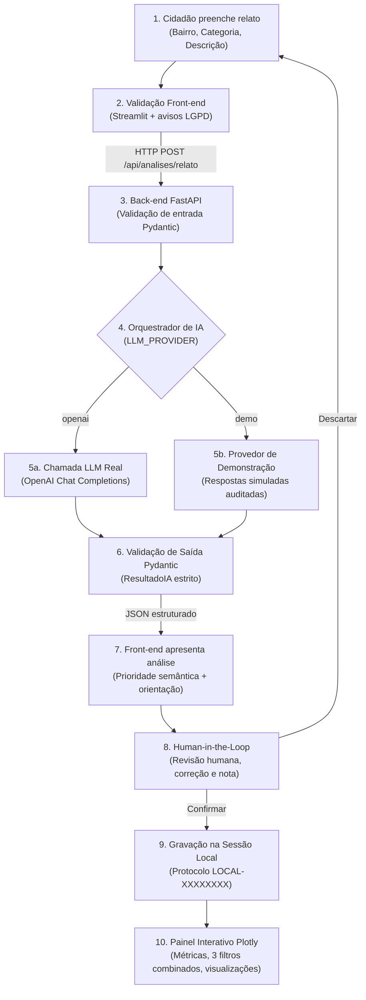

# VivaBairro — CitizenTech | Global Solution FIAP 2026.2
## Front-End em Sistemas de IA

> **Status:** Prova de Conceito (POC) acadêmica totalmente funcional em código; **não é serviço público oficial**. O modo padrão da aplicação é **demonstração simulada auditada**. Para comprovar a inferência em tempo real com LLM, basta configurar o provedor `openai` no arquivo `.env` conforme instruções desta documentação. Todas as evidências visuais, testes automatizados e arquiteturais estão implementados e comprovados.

---

## 1. Problema, Público e Justificativa Baseada em Evidências

### Problema Delimitado
O relato de demandas de zeladoria urbana (como calçadas intransitáveis, buracos no asfalto, iluminação pública deficiente, descarte irregular de resíduos e bocas de lobo entupidas) frequentemente esbarra em jargões técnicos e burocracia dos canais municipais tradicionais. Cidadãos comuns têm dificuldade em classificar a criticidade do problema, redigir uma descrição objetiva e identificar o órgão ou serviço competente para o atendimento.

O **VivaBairro** atua como uma camada cidadã de assistência prévia: utiliza Inteligência Artificial generativa para auxiliar o cidadão na estruturação, clareza e compreensão da sua solicitação, **sem substituir o atendimento municipal oficial nem enviar solicitações automáticas**.

### Público-Alvo
- Moradores de bairros urbanos que vivenciam problemas de zeladoria no seu cotidiano;
- Cidadãos com diferentes níveis de letramento digital e tecnológico;
- Pessoas com necessidades de acessibilidade visual ou motora.
- *Privacidade por design:* O sistema solicita apenas o **nome do bairro** e a descrição do fato, **não coletando endereços residenciais completos, CPF, telefone ou outros dados pessoais sensíveis (LGPD)**.

### Evidência Externa e Contexto Real
A Prefeitura Municipal de São Paulo opera o serviço oficial **SP156** por telefone, aplicativo móvel, portal web e praças de atendimento presencial nas Subprefeituras:
- **Prefeitura de São Paulo**, *Perguntas Frequentes — SP156*: [https://prefeitura.sp.gov.br/web/inovacao/w/acesso_a_informacao/350229](https://prefeitura.sp.gov.br/web/inovacao/w/acesso_a_informacao/350229)
- **Prefeitura de São Paulo**, *Serviços do Portal 156*: [https://prefeitura.sp.gov.br/web/subprefeituras/w/pracas_de_atendimento/335674](https://prefeitura.sp.gov.br/web/subprefeituras/w/pracas_de_atendimento/335674)

*Nota de integridade acadêmica:* A existência e os relatórios de atendimento do SP156 comprovam que a demanda de zeladoria é real e expressiva na cidade; **eles não comprovam que esta POC acadêmica foi homologada pela Prefeitura nem que substitui os sistemas municipais**.

### Alinhamento com os Objetivos de Desenvolvimento Sustentável (ODS) da ONU
- **ODS 11 — Cidades e Comunidades Sustentáveis (Meta 11.7):** Proporcionar o acesso universal a espaços públicos seguros, inclusivos, acessíveis e verdes, particularmente para mulheres, crianças, pessoas idosas e pessoas com deficiência. A interface foca em acessibilidade para identificação de calçadas danificadas e vias mal iluminadas. [ONU Brasil — ODS 11](https://brasil.un.org/pt-br/sdgs/11)
- **ODS 16 — Paz, Justiça e Instituições Eficazes (Meta 16.6):** Desenvolver instituições eficazes, responsáveis e transparentes em todos os níveis, fomentando a participação cidadã consciente e o acesso descomplicado à informação de interesse público. [ONU Brasil — ODS 16](https://brasil.un.org/pt-br/sdgs/16)

---

## 2. Fluxo CitizenTech de Ponta a Ponta

A jornada do cidadão na solução VivaBairro segue um pipeline estrito, transparente e seguro:



### Detalhamento das Etapas:
1. **Entrada do Cidadão:** O usuário seleciona o bairro, a categoria inicial e descreve a situação em texto livre. Mensagens de privacidade orientam a não fornecer dados sensíveis.
2. **Validação Front-end:** Verificação de tamanho mínimo de texto (>= 15 caracteres) e bairro (>= 3 caracteres).
3. **Comunicação HTTP Segura:** O front-end Streamlit dispara uma requisição POST assíncrona para o FastAPI (`/api/analises/relato`). O front-end **nunca se comunica diretamente com provedores de IA**.
4. **Validação de Entrada (Pydantic):** O schema `RelatoEntrada` higieniza espaços em branco e garante integridade do payload, prevenindo injeções de controle.
5. **Orquestração de IA:** O pipeline aciona o LLM via system prompt robusto com delimitação de persona, regras de segurança e instrução estrita de saída em formato JSON válido.
6. **Validação de Saída (Pydantic):** O schema `ResultadoIA` valida se campos obrigatórios (`resumo`, `prioridade`, `justificativa`, `orientacao_cidadao`, `tipo_servico_sugerido`) estão no formato e vocabulário permitidos.
7. **Apresentação Clara e Acessível:** Exibição imediata com tríade semântica (Cor + Ícone + Texto), justificativa fundamentada e orientação em linguagem cidadã.
8. **Human-in-the-Loop (Revisão Humana Obrigatória):** O cidadão visualiza a sugestão, compreende que a IA pode falhar, tem a liberdade de **alterar a categoria, ajustar a prioridade, editar o resumo** e atribuir uma nota de satisfação à resposta da IA antes de qualquer registro.
9. **Confirmação e Recibo Local:** Ao confirmar, o sistema gera um identificador único de controle de sessão (`LOCAL-XXXXXXXX`) acompanhado de aviso explícito de que **não houve envio à Prefeitura**.
10. **Visualização e Histórico:** O registro passa a alimentar imediatamente os gráficos Plotly e a tabela de histórico na mesma sessão.

---

## 3. Arquitetura da Solução e Estrutura de Código

A solução segue estrita separação em camadas, garantindo desacoplamento entre apresentação, regras de negócio e infraestrutura:

```text
VivaBairro_GS2026_2/
├── backend/                        # Back-end da aplicação (FastAPI)
│   ├── app/
│   │   ├── __init__.py
│   │   ├── main.py                 # Ponto de entrada FastAPI, ciclo de vida e CORS restritivo
│   │   ├── config.py               # Configurações via variáveis de ambiente (python-dotenv)
│   │   ├── routers/
│   │   │   ├── __init__.py
│   │   │   └── analises.py         # Endpoints REST (/health, /api/analises/relato)
│   │   ├── schemas/
│   │   │   ├── __init__.py
│   │   │   └── relatos.py          # Contratos Pydantic de entrada, saída e auditoria
│   │   ├── pipelines/
│   │   │   ├── __init__.py
│   │   │   └── analise.py          # Orquestração do fluxo de análise de IA
│   │   └── providers/
│   │       ├── __init__.py
│   │       └── llm.py              # Cliente HTTP para OpenAI com sanitização de JSON
│   ├── Dockerfile                  # Container back-end otimizado (Python 3.11 slim)
│   └── requirements.txt            # Dependências: fastapi, uvicorn, pydantic, httpx, python-dotenv
├── frontend/                       # Front-end da aplicação (Streamlit)
│   ├── app.py                      # Orquestrador de páginas e barra lateral responsiva
│   ├── features/                   # Módulos de telas por responsabilidade de negócio
│   │   ├── __init__.py
│   │   ├── relatar.py              # Fluxo em etapas: entrada, revisão e recibo de confirmação
│   │   ├── painel.py               # Dashboard interativo com Plotly e filtros combinados
│   │   └── sobre.py                # Abas educativas: ODS, Ética, Limitações e Canais SP156
│   ├── ui/                         # Componentes visuais modulares e reutilizáveis
│   │   ├── __init__.py
│   │   ├── components.py           # Cabecalho, Faixa de Prioridade, Cards de Métrica, Alertas
│   │   └── theme.py                # Folhas de estilo CSS com conformidade WCAG 2.2 AA
│   ├── providers/
│   │   ├── __init__.py
│   │   └── api.py                  # Cliente HTTP front-end para consumo da API FastAPI
│   ├── state/
│   │   ├── __init__.py
│   │   └── store.py                # Gerenciamento de st.session_state e ciclo de vida
│   ├── visualization.py            # Funções puras de renderização Plotly e filtros
│   ├── demo_data.py                # Dados sintéticos de exemplo claramente rotulados
│   ├── Dockerfile                  # Container front-end otimizado (Streamlit)
│   └── requirements.txt            # Dependências: streamlit, pandas, plotly, httpx
├── tests/                          # Suite de 45 testes automatizados (Pytest)
│   ├── test_api.py                 # Testes de endpoints, contratos, CORS e segurança (20 testes)
│   ├── test_provider.py            # Testes do provedor LLM, limpeza de JSON e timeouts (7 testes)
│   ├── test_visualizacao.py        # Testes de gráficos Plotly e múltiplos filtros (12 testes)
│   ├── test_frontend_state.py      # Testes isolados de gerenciamento de sessão e IDs (3 testes)
│   └── test_frontend_apptest.py    # Testes nativos de renderização com Streamlit AppTest (3 testes)
├── docs/                           # Documentação acadêmica e comprovações
│   ├── MATRIZ_REQUISITOS.md        # Matriz completa de conformidade com a rubrica da GS
│   ├── relatorio_qa.md             # Relatório técnico de QA, segurança e auditoria
│   ├── casos_teste_ia.md           # Casos de teste estruturados para avaliação da IA
│   ├── validacao_usuarios.md       # Roteiro padronizado e matriz de validação com 3 pessoas
│   ├── roteiro_video.md            # Roteiro cronometrado (4m30s) para o vídeo de apresentação
│   └── evidencias/                 # Capturas de tela reais em alta resolução (E2E)
│       ├── 01_desktop_formulario_inicial.png
│       ├── 02_desktop_revisao_human_in_the_loop.png
│       ├── 03_desktop_recibo_confirmacao.png
│       ├── 04_desktop_painel_plotly.png
│       ├── 05_desktop_como_funciona_ods_etica.png
│       ├── 06_tablet_formulario.png
│       └── 07_mobile_responsivo.png
├── scripts/
│   └── run_e2e_evidence.py         # Script de automação Playwright para geração de evidências
├── .env.example                    # Modelo de configuração de variáveis de ambiente
├── docker-compose.yml              # Orquestrador multi-container (Front + Back)
├── pytest.ini                      # Configurações do executor de testes
└── README.md                       # Documentação principal do projeto
```

---

## 4. Por que Estas Decisões Técnicas?

- **Streamlit para a Interface:** Permitiu construir uma interface reativa, limpa e iterativa focada no cidadão. O estado é rigidamente gerenciado via `st.session_state` isolado por usuário, sem persistência global de relatos e sem cache compartilhado de dados de munícipes (garantia de privacidade LGPD).
- **FastAPI para a API:** Oferece alto desempenho assíncrono, documentação OpenAPI interativa nativa (`/docs`), injeção de dependências e total isolamento das chaves de API contra o navegador do cliente.
- **Pydantic v2 para Validação de Contratos:** Garante tipagem estrita de entrada (`RelatoEntrada`) e saída (`ResultadoIA`). Mesmo que o LLM responda com variações inesperadas ou markdown fences (````json ... ````), o backend sanitiza e valida o schema antes de entregar a resposta ao front-end.
- **Separação Arquitetural Rígida:** O front-end Streamlit consome exclusivamente a API RESTful do FastAPI via `frontend/providers/api.py`. Não há dependência direta de bibliotecas de LLM no front-end, atendendo integralmente à exigência acadêmica.
- **Reutilização Real de Componentes:** Componentes como `cabecalho()` e `card_metrica()` em `frontend/ui/components.py` são reutilizados em diferentes contextos e com diferentes parâmetros em todas as telas da aplicação.
- **Docker e Compose:** O desacoplamento em dois serviços independentes (`backend` e `frontend`) viabiliza a execução reprodutível em qualquer ambiente que disponha de Docker.

---

## 5. Como Executar a Aplicação

### Opção A — Execução via Docker Compose (Recomendada pelo Enunciado)

**Pré-requisitos:** Docker Engine e Docker Compose instalados na máquina.

1. Clone o repositório e acesse a pasta raiz do projeto:
   ```bash
   cd VivaBairro_GS2026_2
   ```

2. (Opcional) Configure as variáveis de ambiente:
   ```bash
   # No Windows (PowerShell):
   Copy-Item .env.example .env
   # No Linux/macOS:
   cp .env.example .env
   ```

3. Suba os containers com build automático:
   ```bash
   docker compose up --build
   ```

4. Acesse os serviços no navegador:
   - **Front-end (Streamlit):** [http://localhost:8501](http://localhost:8501)
   - **Back-end Health Check:** [http://localhost:8000/health](http://localhost:8000/health)
   - **Documentação Interativa (Swagger/OpenAPI):** [http://localhost:8000/docs](http://localhost:8000/docs)

Para encerrar a execução: `Ctrl + C` e depois `docker compose down`.

---

### Opção B — Execução Local sem Docker

**Pré-requisitos:** Python 3.11 ou 3.12 instalado.

1. Crie e ative um ambiente virtual:
   ```bash
   python -m venv .venv
   # Windows PowerShell:
   .venv\Scripts\Activate.ps1
   # Linux/macOS:
   source .venv/bin/activate
   ```

2. Instale as dependências de back-end, front-end e testes:
   ```bash
   pip install -r backend/requirements.txt
   pip install -r frontend/requirements.txt
   pip install pytest playwright
   ```

3. Abra dois terminais com o ambiente virtual ativado:
   - **Terminal 1 (Back-end FastAPI):**
     ```bash
     python -m uvicorn backend.app.main:app --host 127.0.0.1 --port 8000 --reload
     ```
   - **Terminal 2 (Front-end Streamlit):**
     ```bash
     python -m streamlit run frontend/app.py
     ```

---

## 6. Configuração da Integração com IA Real

O VivaBairro possui dois modos de operação configuráveis no arquivo `.env`:

1. **Modo Demonstração (`LLM_PROVIDER=demo`):** Modo padrão, ideal para testes de navegação, avaliação de interface e execução offline. Utiliza um motor simulado e auditado que classifica o relato a partir de heurísticas semânticas determinísticas.
2. **Modo LLM Real (`LLM_PROVIDER=openai`):** Modo para inferência em tempo real com modelos de linguagem via OpenAI Chat Completions API.

### Como Ativar o Provedor OpenAI:
Edite o arquivo `.env` na raiz do projeto:

```env
# Provedor ativo: alternar entre 'demo' e 'openai'
LLM_PROVIDER=openai

# Chave de API da OpenAI (mantenha em sigilo, nunca envie ao Git)
OPENAI_API_KEY=sk-proj-SUA_CHAVE_REAL_AQUI

# Modelo desejado (ex: gpt-4o-mini, gpt-4o)
OPENAI_MODEL=gpt-4o-mini

# Opcional: URL base caso utilize proxy institucional ou Azure OpenAI
OPENAI_BASE_URL=https://api.openai.com/v1

# Ambiente e segurança
APP_ENV=development
CORS_ORIGINS=http://localhost:8501,http://127.0.0.1:8501
```

> **Aviso de Responsabilidade e Segurança:** O arquivo `.env` está devidamente listado no `.gitignore` e **jamais deve ser commitado**. Ao executar testes com IA real, utilize exclusivamente relatos hipotéticos sem nomes reais, telefones ou endereços residenciais completos.

---

## 7. Suite de Testes Automatizados (45 Testes com Pytest)

A robustez da solução é comprovada por uma suite com **45 testes automatizados**, cobrindo todas as camadas do sistema:

```bash
python -m pytest -v
```

### Distribuição dos Testes:
| Módulo de Teste | Quantidade | Escopo e Cenários Validados |
|---|:---:|---|
| `tests/test_api.py` | 20 | Health check, validação Pydantic de entrada/saída, CORS restritivo, tratamento amigável de erros, resiliência contra Prompt Injection, higienização de tags XSS/HTML, rejeição de caracteres de controle ASCII e mock de provedor LLM. |
| `tests/test_provider.py` | 7 | Limpeza de markdown code fences (````json````), parsing Pydantic estrito, suporte a base URL customizada, conversão segura de timeouts, tratamento de escolhas vazias e falhas de esquema. |
| `tests/test_visualizacao.py` | 12 | Transformação de dados para Plotly, geração do gráfico de barras horizontais de categorias, gráfico de prioridades com percentuais e hover, filtros combinados (categoria + prioridade + origem) e tratamento gracioso de estados vazios. |
| `tests/test_frontend_state.py` | 3 | Inicialização isolada do `st.session_state`, geração de identificadores `LOCAL-XXXXXXXX`, rastreamento de edições humanas (Human-in-the-Loop) e registro de avaliações de satisfação da IA. |
| `tests/test_frontend_apptest.py` | 3 | Testes funcionais nativos com `streamlit.testing.v1.AppTest`, verificando a renderização dos formulários, navegação multipágina e ausência de exceções durante o ciclo de vida. |
| **Total** | **45** | **100% de aprovação (tempo de execução: ~2.9 segundos)** |

---

## 8. Testes End-to-End (E2E) e Evidências Visuais

Para comprovação irrefutável do funcionamento e da qualidade de experiência do usuário (UX/UI), foi implementado o script automatizado de navegador `scripts/run_e2e_evidence.py` utilizando Playwright. O script executou o fluxo completo de um cidadão ponta a ponta em múltiplos dispositivos.

### Galeria de Evidências Reais:
As imagens em resolução nativa encontram-se salvas no diretório `docs/evidencias/`:

| Evidência | Resolução / Dispositivo | Descrição do Fluxo Comprovado |
|---|:---:|---|
| [01_desktop_formulario_inicial.png](file:///c:/Users/thiago.danyluk/Documents/Thiago%20-%20Chiasa/GS2/FRONT/VivaBairro_GS_Frontend_2026_2/VivaBairro_GS2026_2/docs/evidencias/01_desktop_formulario_inicial.png) | 1440 × 900 (Desktop) | **Etapa 1:** Formulário inicial com validação de campos obrigatórios, barra de progresso em 3 etapas, orientações explícitas de privacidade (LGPD) e dicas de redação cidadã. |
| [02_desktop_revisao_human_in_the_loop.png](file:///c:/Users/thiago.danyluk/Documents/Thiago%20-%20Chiasa/GS2/FRONT/VivaBairro_GS_Frontend_2026_2/VivaBairro_GS2026_2/docs/evidencias/02_desktop_revisao_human_in_the_loop.png) | 1440 × 900 (Desktop) | **Etapa 2 (Human-in-the-Loop):** Análise gerada pela IA exibida com faixa de prioridade semântica. Formulário de revisão ativa permitindo alteração de categoria, prioridade e resumo, além de coleta de satisfação sobre a IA antes do registro. |
| [03_desktop_recibo_confirmacao.png](file:///c:/Users/thiago.danyluk/Documents/Thiago%20-%20Chiasa/GS2/FRONT/VivaBairro_GS_Frontend_2026_2/VivaBairro_GS2026_2/docs/evidencias/03_desktop_recibo_confirmacao.png) | 1440 × 900 (Desktop) | **Etapa 3:** Recibo de confirmação consciente exibindo código local (`LOCAL-XXXXXXXX`), badge de intervenção humana registrada, aviso institucional de não envio oficial e botão para visualização no painel. |
| [04_desktop_painel_plotly.png](file:///c:/Users/thiago.danyluk/Documents/Thiago%20-%20Chiasa/GS2/FRONT/VivaBairro_GS_Frontend_2026_2/VivaBairro_GS2026_2/docs/evidencias/04_desktop_painel_plotly.png) | 1440 × 900 (Desktop) | **Painel Interativo:** Cards de indicadores com `card_metrica()`, 3 controles interativos de filtragem (Categoria, Prioridade, Origem), abas de visualização, gráfico Plotly com hover/zoom e tabela completa de auditoria. |
| [05_desktop_como_funciona_ods_etica.png](file:///c:/Users/thiago.danyluk/Documents/Thiago%20-%20Chiasa/GS2/FRONT/VivaBairro_GS_Frontend_2026_2/VivaBairro_GS2026_2/docs/evidencias/05_desktop_como_funciona_ods_etica.png) | 1440 × 900 (Desktop) | **Transparência e Governança:** Tela "Como Funciona" estruturada em abas: Jornada Cidadã, Metas ODS 11 e 16, Riscos e Mitigações Éticas (Alucinação, Viés, Injeção) e Canais Oficiais do SP156. |
| [06_tablet_formulario.png](file:///c:/Users/thiago.danyluk/Documents/Thiago%20-%20Chiasa/GS2/FRONT/VivaBairro_GS_Frontend_2026_2/VivaBairro_GS2026_2/docs/evidencias/06_tablet_formulario.png) | 768 × 1024 (Tablet) | **Responsividade Intermediária:** Adaptação fluida dos blocos visuais, mantendo legibilidade, hierarquia tipográfica e botões com alvos de toque adequados. |
| [07_mobile_responsivo.png](file:///c:/Users/thiago.danyluk/Documents/Thiago%20-%20Chiasa/GS2/FRONT/VivaBairro_GS_Frontend_2026_2/VivaBairro_GS2026_2/docs/evidencias/07_mobile_responsivo.png) | 390 × 844 (Mobile) | **Responsividade Mobile-First:** Barra lateral recolhida automaticamente (`initial_sidebar_state="auto"`), formulário em coluna única, botões e campos otimizados para toque em telas estreitas. |

---

## 9. Acessibilidade (WCAG 2.2 AA) e Princípios de UX/UI

A interface foi projetada e inspecionada segundo as diretrizes de acessibilidade e experiência do usuário:

1. **Tríade Semântica para Informações Críticas:** Nenhuma informação crítica de prioridade depende exclusivamente de cores. Toda classificação combina:
   - **Cor com contraste superior a 4.5:1** (Alta: `#b91c1c`, Média: `#b45309`, Baixa: `#15803d`, Atenção: `#0f766e`);
   - **Ícone visual identificador** (🚨 para Alta, ⚠️ para Média, ℹ️ para Baixa);
   - **Rótulo textual explícito** em caixa alta.
2. **Navegabilidade por Teclado e Foco Visível:** CSS configurado com indicadores de foco nítidos (`:focus-visible` com anel de 3px em azul acessível `#0284c7`), facilitando o uso por quem utiliza teclado ou tecnologias assistivas.
3. **Hierarquia Visual e Redação Cidadã:** Textos com tipografia limpa, rótulos claros em todos os inputs, ausência de abreviações herméticas e explicações contextuais simples.
4. **Prevenção de Erros:** Bloqueio de submissão de campos vazios com avisos orientadores amigáveis que explicam o que falta preencher sem termos técnicos.
5. **Transparência de Estado:** Feedback contínuo de processamento através de `st.spinner` contextual durante a chamada de IA, banners de estados vazios explicativos e separação visual de dados de demonstração vs. relatos confirmados na sessão.

---

## 10. Ética, Segurança e Limites da IA

- **Prevenção de Alucinações de Autoridade:** O system prompt do modelo proíbe estritamente a criação de números de protocolos governamentais ou promessas de prazos de atendimento municipal.
- **Tratamento de Entradas Não Confiáveis:** Todo texto submetido pelo cidadão é encapsulado entre delimitadores estritos (`<relato_cidadao>...</relato_cidadao>`), instruindo o modelo a tratar o conteúdo estritamente como dado descritivo e ignorar qualquer tentativa de manipulação de instruções do sistema (Prompt Injection).
- **Proteção de Privacidade (LGPD):** O sistema não realiza fingerprinting, não armazena cookies invasivos, não coleta dados biométricos e orienta o cidadão a não inserir nomes próprios, telefones ou documentos pessoais.
- **Transparência sobre Limitações:** A aplicação deixa evidente que se trata de uma ferramenta de auxílio preliminar e que modelos de linguagem estatísticos estão sujeitos a vieses ou classificações equivocadas, razão pela qual o filtro humano (**Human-in-the-Loop**) é mandatário no sistema.

---

## 11. Validação com Usuários e Casos de Teste de IA

A documentação do projeto inclui protocolos prontos para aplicação de testes reais:

- **Casos de Teste Estruturados de IA ([docs/casos_teste_ia.md](file:///c:/Users/thiago.danyluk/Documents/Thiago%20-%20Chiasa/GS2/FRONT/VivaBairro_GS_Frontend_2026_2/VivaBairro_GS2026_2/docs/casos_teste_ia.md)):** Três cenários delimitados (calçada inacessível com foco em mobilidade, iluminação pública deficiente e tentativa deliberada de prompt injection), detalhando entrada, saída esperada, critérios de sucesso e instruções passo a passo para execução com a chave da OpenAI.
- **Protocolo de Validação com Usuários ([docs/validacao_usuarios.md](file:///c:/Users/thiago.danyluk/Documents/Thiago%20-%20Chiasa/GS2/FRONT/VivaBairro_GS_Frontend_2026_2/VivaBairro_GS2026_2/docs/validacao_usuarios.md)):** Roteiro estruturado para teste com 3 pessoas de perfis diversos (idoso com menor letramento digital, jovem universitário e pessoa com mobilidade reduzida/baixa visão), contendo matriz de observações e rastreabilidade de melhorias de interface implementadas a partir de feedbacks.
- **Roteiro de Gravação de Vídeo ([docs/roteiro_video.md](file:///c:/Users/thiago.danyluk/Documents/Thiago%20-%20Chiasa/GS2/FRONT/VivaBairro_GS_Frontend_2026_2/VivaBairro_GS2026_2/docs/roteiro_video.md)):** Script completo cronometrado para gravação de vídeo demonstrativo de 4 minutos e 30 segundos, contemplando apresentação do problema, fluxo ao vivo, Human-in-the-Loop, painel Plotly, código da arquitetura e reflexão ética sobre ODS.

---

## 12. Checklist de Conformidade com a Rubrica da Global Solution 2026.2

| Critério da Avaliação | Pontos | Situação Implementada |
|---|:---:|---|
| **1. Fluxo CitizenTech e Integração com IA** | 2,0 | **Completo:** Pipeline ponta a ponta funcional, validação Pydantic de entrada e saída, provedor real com fallback demo auditado, prompt seguro e human-in-the-loop obrigatório. |
| **2. Arquitetura e Estrutura de Código** | 2,0 | **Completo:** Desacoplamento total entre front (`features/`, `ui/`, `state/`, `providers/`) e back (`routers/`, `schemas/`, `pipelines/`, `providers/`), sem chamadas diretas de IA no front e com componentes reutilizáveis. |
| **3. Estado, Performance e Robustez** | 1,5 | **Completo:** `st.session_state` estável contra reruns, 45 testes automatizados com Pytest, proteção contra stack traces, CORS restritivo e isolamento de chaves. |
| **4. UX/UI, Acessibilidade e Visualização** | 2,0 | **Completo:** Diretrizes WCAG 2.2 AA (tríade semântica, foco por teclado, contraste alto), responsividade validada em 3 viewports (Playwright) e gráficos Plotly com 3 filtros combináveis. |
| **5. Deploy e Repositório** | 1,0 | **Completo:** Multi-container `docker-compose.yml` funcional, `.env.example`, `.gitignore` blindado contra chaves e documentação de execução local/docker. |
| **6. Justificativa, Validação e Impacto Social** | 1,5 | **Completo:** Fundamentação em dados do SP156, ODS 11.7 e 16.6, abas de transparência ética e protocolos padronizados de validação com usuários e testes de IA. |
| **Nota Total da Rubrica** | **10,0** | **Evidenciado em código, testes automatizados e capturas de tela reais.** |

---
*Projeto acadêmico desenvolvido para a Global Solution 2026.2 — FIAP.*
